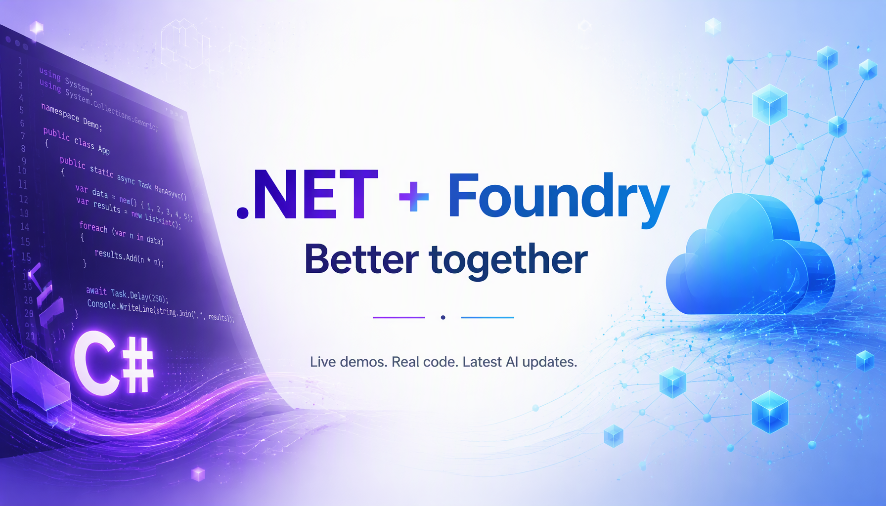

# .NET + Foundry, Better together



What can you build with .NET and Microsoft Foundry? Join **[Bruno Capuano](https://aka.ms/elbruno) and guests** for practical explorations of new SDK capabilities, the latest Foundry features and services, and building AI applications with C#.

Live on the [.NET YouTube channel](https://www.youtube.com/@dotnet/streams) and [Microsoft Reactor](https://www.youtube.com/@MicrosoftReactor/streams).

**Repository:** [aka.ms/netfoundry-bt](https://aka.ms/netfoundry-bt)

**Series and registration:** [Microsoft Reactor](https://developer.microsoft.com/en-us/reactor/series/S-1718/)

## Episodes

All sessions run **12:00-1:00 PM Eastern Time**. UTC times below account for the daylight saving time change in November.

| Episode | Date | UTC | Event and registration | Materials | Recordings |
| --- | --- | --- | --- | --- | --- |
| 1 | October 15, 2026 | 16:00-17:00 | [Episode 1: Decision Models in Action](https://developer.microsoft.com/en-us/reactor/events/27630/) | [Episode folder](episodes/01-2026-10-15/README.md) | [.NET](https://www.youtube.com/watch?v=mHrs-JHdPaY) / [Reactor](https://www.youtube.com/watch?v=n2CL10iTjp0) |
| 2 | October 29, 2026 | 16:00-17:00 | [.NET + Foundry, better together](https://developer.microsoft.com/en-us/reactor/events/27631/) | [Episode guide](episodes/02-2026-10-29/README.md) | Not yet available |
| 3 | November 12, 2026 | 17:00-18:00 | [Episode 3](https://developer.microsoft.com/en-us/reactor/events/27632/) | [Episode folder](episodes/03-2026-11-12/README.md) | Not yet available |
| 4 | December 3, 2026 | 17:00-18:00 | [Episode 4](https://developer.microsoft.com/en-us/reactor/events/27634/) | [Episode folder](episodes/04-2026-12-03/README.md) | Not yet available |

Episode 2 features co-speaker [Jose Luis Latorre](https://www.linkedin.com/in/joslat/) and focuses on Hosted Agents using decision models and agent memory. The support-routing demo progresses from a direct C# decision-model call, to a local Microsoft Agent Framework agent, to a Foundry Hosted Agent. The discussion compares Foundry Memory Stores with custom AgentMemory; custom-memory integration with a Hosted Agent remains exploratory. See the [episode guide](episodes/02-2026-10-29/README.md) and its [three-stage demo progression](episodes/02-2026-10-29/demos/01-console-decision-model/README.md).

Later episode topics will be shared closer to their sessions.

## Episode materials

After each episode, this repository will be updated with the recording link, demo code, and related resources.

Materials are organized by episode number and date under `episodes/`. Each episode README links to its recording, demos, and resources as they become available. Each demo will include its own setup and run instructions.

Episode 1 also includes a [graphical Decision Space Game finale](episodes/01-2026-10-15/demos/09-space-game-monogame/README.md):
play manually without credentials, then explicitly hand control to Foundry or Ollama.
[Version 02](episodes/01-2026-10-15/demos/10-space-game-monogame-v02/README.md) keeps those rules and uses a larger streaming layout with light and dark themes.

Episode 1 was co-hosted by [Pablo Piovano](https://www.linkedin.com/in/ppiova/),
who shared demos from [Foundry Field Notes labs](https://github.com/ppiova/foundry-field-notes-labs).
Find his lab links alongside the recordings and this repository's demos in the
[Episode 1 guide](episodes/01-2026-10-15/README.md).

## Contributing

See [the contribution guide](CONTRIBUTING.md) for the folder layout and a short checklist for demos and documentation.

## Series website

The GitHub Pages site is configured for **https://elbruno.github.io/NETFoundry-BetterTogether/**.
It becomes available after the first successful deployment. It includes episode guides,
demo links, registration, calendar downloads, local session times, and System/Light/Dark themes.

Requires Node.js 22.12 or newer (Node.js 24 is used for deployment):

```powershell
npm ci
npm run dev
```

Open the local URL printed by Astro, including `/NETFoundry-BetterTogether/`.
Use `npm test` for content checks, `npm run check` to type-check templates,
`npm run build` to generate `dist/`, and
`npm run preview` to preview that production output. No Azure credentials or
billable model calls are needed for the website.

The [website maintenance guide](docs/website.md) explains content updates and deployment.
