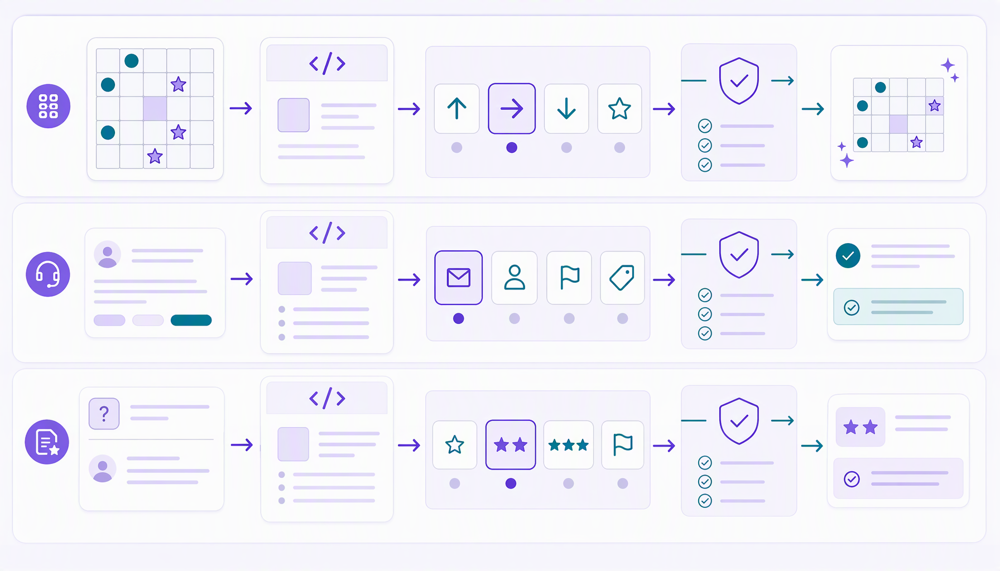

# Episode 1: .NET + Foundry, Better together

**Date:** October 15, 2026, 12:00-1:00 PM EDT (16:00-17:00 UTC).

**Event and registration:** [Microsoft Reactor](https://developer.microsoft.com/en-us/reactor/events/27630/)

## Overview

Explore Microsoft-Decision-1 and the emerging category of decision models, then
put decisions to work in .NET 10 and C#. Start with a bounded choice in Foundry,
compare decision and generative model approaches, try decisions in review
workflows, and finish by watching a model choose actions in games. The console
space game is the main finale; a graphical platformer and MonoGame space game
are optional extensions.



Decision models return bounded, typed results for the choices your application
defines; they don't write a free-form answer or explanation. In these examples,
application code remains in control: it validates results and applies game
actions. Model scores and probabilities are useful signals, not guarantees of
correctness. The .NET decision samples use the community
`ElBruno.AI.Decisions` SDK, not an official Microsoft SDK.

## Official Microsoft resources

- [Microsoft-Decision-1: Our model for fast decision-making](https://commandline.microsoft.com/microsoft-decision-1-model-foundry/)
- [Deploy and use Microsoft-Decision-1 in Microsoft Foundry - Microsoft Foundry | Microsoft Learn](https://learn.microsoft.com/en-us/azure/foundry/foundry-models/how-to/use-foundry-models-microsoft-decision)
- [Microsoft models sold by Azure in the Foundry catalog](https://learn.microsoft.com/en-us/azure/foundry/foundry-models/concepts/models-sold-directly-by-azure#microsoft-models-sold-by-azure): model details and availability.
- [Understand Microsoft Foundry model deployment types](https://learn.microsoft.com/en-us/azure/foundry/foundry-models/concepts/deployment-types): deployment options and where inference is processed.

## Recording

The recording link will be added after the episode.

## Demos and resources

Recommended learning order (folder numbers now match the walkthrough):

1. [Hello Decisions](demos/01-hello-decisions/README.md): one console app, one prompt, one decision using the community SDK.
2. [Hello Decisions with Ollama](demos/02-hello-decisions-ollama/README.md): the same prompt, labels, and output with a local native decision client.
3. [Same question, two models](demos/03-compare-decisions/README.md): MEAI chat versus native decision SDK, elapsed time and SDK-exposed usage.
4. [Support inbox triage](demos/04-support-triage/README.md): Choice, Score, Assess, and application-owned review policy for one synthetic ticket.
5. [Answer-quality review](demos/05-answer-review/README.md): model-assisted review, not automatic approval.
6. [Decision Lab](demos/06-decision-lab/README.md): Blazor, parallel repeated questions, live usage totals, cancellation, and Aspire GenAI traces.
7. [Decision Space Game](demos/07-decision-space-game/README.md): apply decisions in a running simulation.
8. [Platformer decisions](demos/08-platformer-decisions/README.md): optional graphical extension with live game-state observations, fixed-step movement/jump controls, and asynchronous Foundry or Ollama decisions.
9. [Decision Space Game: graphical finale](demos/09-space-game-monogame/README.md): MonoGame welcome screen, generated spaceship art, manual play, and explicit Foundry/Ollama takeover using the console game's rules.
10. [Decision Space Game v02](demos/10-space-game-monogame-v02/README.md): the same rules and decisions, with a light/dark streaming layout, larger smooth ships, and a larger font. Demo 09 stays unchanged.

The original walkthrough remains demos 01 through 07. Demos 08, 09 and 10 are optional
extensions, not replacements or renumberings of the existing game.

## What we'll explore

- **Meet Microsoft-Decision-1:** where decision models fit beside generative
  models, and when a C# application needs a bounded choice rather than generated
  prose.
- **Make native decisions:** use the Foundry decision API with choice, score,
  and yes/no questions; compare its structured results with a generative model.
- **Put decisions to work:** explore ticket triage, answer-quality review,
  confidence and probability signals, and application-owned human review.
- **Let decisions play:** map bounded model choices to legal actions in a
  console space game, with optional graphical platformer and MonoGame extensions.
- **Keep software in control:** the application owns game rules, movement,
  action validation, and whether a model suggestion is applied.

Existing project names and user-secrets IDs are unchanged; the new Ollama sample
has its own ID. Update local working-directory shortcuts to the new paths.
Each introductory console sample has one commented `Program.cs`, no command-line options,
and runs with `dotnet run`. Change the prompt directly in source. The game has a
similarly small entry point, with the simulation/rendering kept separately.
The larger Blazor demo uses Aspire and has its own run instructions.
Decision SDK 0.6.3 exposes provider-reported token usage in both comparison demos.
Live native Foundry input/output counters work; omitted totals stay not reported,
not inferred. The shipped feature is
[elbruno/ElBruno.AI.Decisions#4](https://github.com/elbruno/ElBruno.AI.Decisions/issues/4).
All decision samples pin **0.6.3**, whose GitHub release remains marked tentative
early access. Foundry Choice/Score/Assess and local nimble usage were live-tested;
provider/version-specific availability can still differ.

### Configure all samples

Requires PowerShell 7 and the .NET 10 SDK. From this episode directory, before
recording or screen sharing:

```powershell
pwsh -File .\Setup-UserSecrets.ps1 -ValidateOnly
pwsh -File .\Setup-UserSecrets.ps1
```

[Setup-UserSecrets.ps1](Setup-UserSecrets.ps1) discovers runnable sample projects,
prompts once for the Foundry resource root and deployment name, and imports
configuration into the nine Foundry apps' separate user-secrets stores. Ten
runnable apps are discovered in total, including local-only demo 02.
The helper excludes Aspire AppHost/ServiceDefaults and test projects. It also
asks for a generative deployment on that same resource for demos 03 and 06.
Press Enter to accept `gpt-6.1-sol`, or type your actual deployment name.
Choose Azure CLI
identity (the default) or enter a key through hidden input. Identity mode removes
any stored `Foundry:ApiKey` so a stale key cannot override identity authentication.
Run `az login` separately and ensure your identity has deployment access.

Optional Ollama prompts configure demo 02 and the O modes in demos 07, 08, 09 and 10.
Press Enter at the model prompt to accept `nimble`, or type another compatible
installed decision model name.
Demo 02 remains local-only, without Foundry values or keys.
They do not install Ollama or download a model. Skipping Ollama leaves that
project's existing settings unchanged. To run only demo 02, its README also
provides direct local configuration commands without requiring Foundry access.
Environment variables override user secrets, so remove conflicting `Foundry__*`
variables when changing authentication mode.

The script does not display supplied values, pass keys as process arguments,
write configuration into this repository, or run chargeable inference. Prompts
for non-key values are visible while you type, so do setup off-stream. .NET user
secrets are unencrypted local development storage, not a production vault. Imports
replace the named keys but preserve unrelated secrets. If setup fails midway,
earlier projects may already be updated; fix the reported prerequisite and rerun.
Use `dotnet user-secrets remove "<key>" --project "<project.csproj>"` for each
configured key when cleaning up. Never display `user-secrets list` on stream.

The setup script has non-writing tests:

```powershell
pwsh -File .\tests\Setup-UserSecrets.Tests.ps1
```

### Related resources

- [Decision Space Game: code, setup, controls, tests, and validation](demos/07-decision-space-game/README.md)
  (.NET 10, ElBruno.AI.Decisions 0.6.3, M manual / F Foundry / O Ollama,
  Spectre.Console battlefield, decision-paced AI turns, optional --foundry/--ollama
  auto-start and outcome/latency/usage mission reports).
- [Platformer decisions: graphical game, structured observations, fixed-step actions, tests, and attribution](demos/08-platformer-decisions/README.md)
  (.NET 10, MonoGame, manual by default, asynchronous Foundry/Ollama choices).
  Build, visible graphical launch and contract/desktop checks were verified.
  With explicit gap/enemy approach observations and jump timing instructions,
  Foundry completed the level alive in two full runs of 41 decisions each.
  Ollama's earlier 20-decision smoke predates this correction. Model success
  is not guaranteed.
- [ElBruno.AI.Decisions](https://github.com/elbruno/ElBruno.AI.Decisions)
- [Microsoft SpaceAINet reference](https://github.com/microsoft/Generative-AI-for-beginners-dotnet/tree/main/samples/AppsWithGenAI/SpaceAINet)

[Back to the series](../../README.md)
