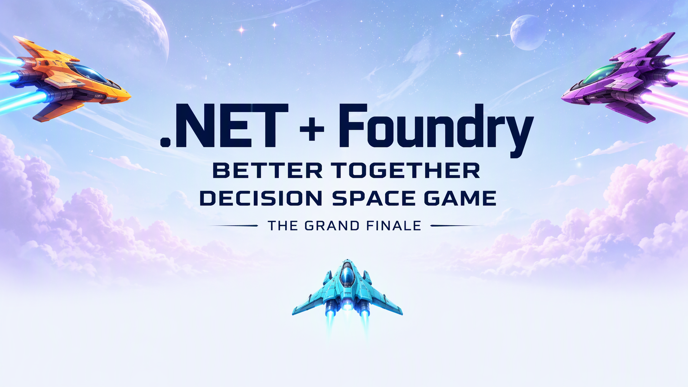

# Decision Space Game v02: streaming layout

A playable .NET + Foundry, Better Together closing mission. This is the
streaming-friendly presentation of demo 09. Demo 09 remains unchanged.
MonoGame draws larger smooth spaceship art while C# owns every movement,
collision and score. The model sees structured state, **not screenshots**.
The rules are the same port of demo 07, not a new wave, boss or physics system.

Light theme is the default. Press T to switch to the dark theme.



## Prerequisites and run

Tested on Windows with .NET SDK **10.0.401**, `net10.0`,
MonoGame DesktopGL and Content Builder Task **3.8.5**, local MGCB tool
**3.8.5-preview.5**, decision providers **0.6.3** and configuration **10.0.0**.
The community decision SDK is not an official Microsoft SDK.
Use a desktop with an OpenGL-capable graphics driver, not a headless terminal.
Other DesktopGL platforms have not been rehearsed for this demo.

From this directory:

```powershell
dotnet tool restore
dotnet restore .\SpaceGameMonoGameV2.slnx --locked-mode
dotnet build .\SpaceGameMonoGameV2.slnx -c Release --no-restore
dotnet test .\SpaceGameMonoGameV2.slnx -c Release --no-restore
dotnet run
```

Expected: a 1920x1080 welcome image with application-rendered branding and
controls. Enter or Space starts **manual play**, without constructing a
provider or contacting the network. The resized window letterboxes the same
logical canvas. The game board uses 44-pixel cells and 96-pixel smooth sprites.
The HUD uses Atkinson Hyperlegible Bold at 22 and 30 points, not a scaled 14-point font.

`Program.cs` loads configuration and defines lazy clients. `Game.cs` is an
independent, unchanged copy of the console engine. `Mission.cs` coordinates
fixed ticks and asynchronous decisions. `SpaceGameWindow.cs` handles input,
sprites, title screen and telemetry. There are no project references or shared
runtime dependencies on demos 07 or 08.

## Controls and rules

| Input | Result |
| --- | --- |
| Enter / Space on welcome | Start manually |
| A/D or Left/Right | Manual horizontal action |
| Space | Manual fire action |
| S or no movement/fire key | Stop at the next action boundary |
| M / F / O | Explicit manual / Foundry / compatible Ollama takeover |
| P | Pause/resume; explicitly resume after focus loss |
| T | Toggle light and dark presentation. Rules and scores do not change |
| N | New seed-42 mission, fresh counters, manual controls |
| Q / Escape | Cancel pending work and quit |

Held manual input is sampled only at four-tick action boundaries, not every
render frame. One selected action lasts four 50 ms ticks. Movement covers up
to four columns. Fire stays still and creates one shot at application time,
not a stream of shots during the lease. Holding Space repeats at the next
boundary; the six-tick cooldown still applies. Space takes priority over
movement, then left over right. Release held action keys after starting,
takeover, pause or focus loss before issuing fresh input.

The board has 32x20 cells, 14 single-hit invaders, three hull points and seed 42.
Player shots travel upward every tick; hostile shots travel down every second
tick. Invaders move every ten ticks, descend when bouncing, and fire every
20 ticks. Each kill scores ten. The three enemy designs are cosmetic.
The six-tick HIT cue is visual feedback, not invulnerability or a power-up.
Victory means no invaders remain. Zero hull or invasion at the player row
means defeat.

## Optional providers: configure off stream

Manual play requires **no credentials or cloud resources**.
For optional AI controls, use the episode helper:

```powershell
pwsh -File ..\..\Setup-UserSecrets.ps1 -ValidateOnly
pwsh -File ..\..\Setup-UserSecrets.ps1
```

It discovers this root-level `SpaceGameMonoGameV2.csproj` and writes a separate
local store, **`netfoundry-episode01-space-game-monogame-v02`**. It does not copy
other demos' stores automatically. Never display secrets or setup prompts while
sharing your screen. User secrets are unencrypted development storage.

Settings: `Foundry:Endpoint` (HTTPS resource root), `Foundry:Model` (actual
native-decision deployment name), optional `Foundry:ApiKey`, `Ollama:Endpoint`
and `Ollama:Model`. Environment equivalents use `__`, for example
`Foundry__Model`. Environment variables override user secrets.
Without an API key, authenticate separately with `az login` and deployment
access. Remove a stale key when choosing identity authentication.
The Ollama defaults are `http://localhost:11434` and `nimble`; install a
compatible native-decision model separately. Arbitrary chat models are not
assumed compatible. No resources or models are provisioned by this game.

Pressing F or O is explicit permission to start inference. The exact offered
labels are `move_left`, `move_right`, `fire`, `stop`; boundary moves and
cooldown fire are excluded. The immutable observation includes geometric
`predictedFireLanes`, grid coordinates and the timing contract. The world
freezes during one request, then applies the validated action for four ticks.
Rendering, pause, mode selection, restart and quit remain responsive.

Focus loss pauses and **regaining focus does not resume AI play**. Press P.
A completed response stays pending while paused. Switching or restarting
cancels and invalidates old work; a new call waits for cancellation drain.
Provider errors, timeout, invalid labels or invalid probability distributions
stop AI visibly. Recovery is explicit with M/F/O or N. There are no retries,
fallback models or scripted live play. Requests have a 60-second deadline.
An uncooperative provider may take longer to drain during shutdown, rather
than overlap requests or dispose a client it is still using.

Any mission that selects AI is bounded by victory, defeat, failure,
1,200 simulation ticks or 300 wall seconds, including pauses. N resets those
bounds. The final battlefield, outcome and telemetry remain visible until
restart or quit.

## Telemetry, costs and cleanup

The sidebar shows actual hull, score, shots, kills, hit rate, selected model
label (never endpoint), action, simulation/wall time, pauses, calls issued,
completed/applied/rejected/error/cancelled, latency and usage coverage.
Returned usage from stale results belongs to its original mission.
Unknown usage is **unknown**, not zero. Reported zero stays zero, and total
tokens are never synthesized by adding input/output or double-counting
cached/reasoning tokens. Accepted action counts are also available in
`MissionStatistics.Actions`. These observations are not a billing ledger.
Different Foundry and Ollama models are not a controlled benchmark.

Foundry inference may incur deployment charges even if a result is cancelled
or discarded. Local Ollama uses your machine's resources. Closing the window
does not delete deployments or stop the Ollama service.
Optional cleanup removes only this demo's settings:

```powershell
dotnet user-secrets clear --project .\SpaceGameMonoGameV2.csproj
```

Do not delete shared cloud resources. Build artifacts can be removed from
this demo's `bin` and `obj` directories.

## Tests and opt-in smokes

The ordinary test suite uses synthetic clients only. It checks deterministic
rules/collisions/RNG, legal labels, four-tick fire/movement, nullable usage,
single-flight cancellation, stale results, timeout/errors, inference/focus/user
pauses, explicit resume, restart attribution, atlas geometry and AI wall limits.
The original rule source is retained without behavioral changes.

To exercise the actual DesktopGL device, welcome art, battlefield pixels,
manual movement and focus pause:

```powershell
$env:SPACEGAME_GRAPHICS_TESTS = '1'
dotnet test .\tests\SpaceGameMonoGameV2.Tests.csproj -c Release --filter 'Category=Graphics'
Remove-Item Env:\SPACEGAME_GRAPHICS_TESTS
```

The next smoke is **opt-in and potentially chargeable**. It uses only this
demo's configuration and runs actual game state for at most eight requests,
32 simulation ticks and 120 wall seconds per provider, plus cancellation
drain. It reports observed score/hull/actions/usage, not a victory claim.
Run one configured provider by selecting its test case, or both:

```powershell
$env:SPACEGAME_LIVE_TESTS = '1'
dotnet test .\tests\SpaceGameMonoGameV2.Tests.csproj -c Release --filter 'Category=LiveProvider' --logger 'console;verbosity=detailed'
Remove-Item Env:\SPACEGAME_LIVE_TESTS
```

Graphics and live tests are skipped unless explicitly enabled. Neither short
smoke establishes a completed AI victory or cross-platform compatibility.
Art is required: missing or wrongly sized PNGs fail by filename, rather than
silently substituting sprites. The atlas is premultiplied and drawn with
`AlphaBlend` and `LinearClamp`. Font content is built by MGCB. See
[art provenance](Content/ARTWORK.md) and [third-party notices](THIRD-PARTY-NOTICES.md),
including the Atkinson Hyperlegible SIL Open Font License.

### Validation

Locked restore, Release build and 48 offline tests passed. The opt-in
DesktopGL test passed with the 1920x1080 welcome art, manual movement, focus
pause and restart. Live Foundry and Ollama gameplay were not rerun for this
presentation change. Demo 09 remains the previously validated build.
`dotnet run --no-build -c Release` also opened a responsive welcome window
from the demo root, then was closed after the smoke check.
Demo 09's earlier real-provider results do not establish live-provider
verification for this separate demo. Start the local Ollama service before
selecting O or running its opt-in live test.
