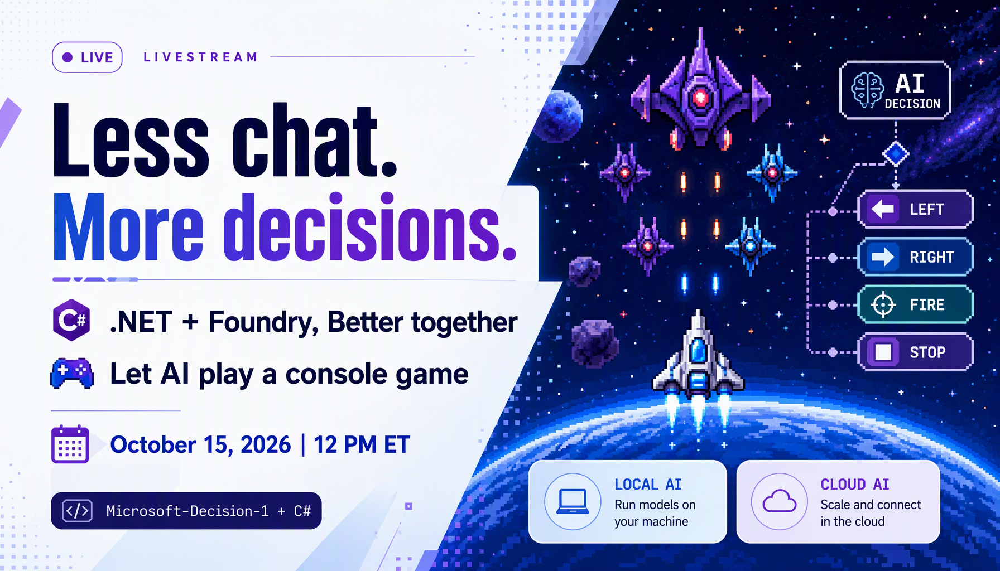

# Episode 1 promotion

Draft posts for October 15, 2026. These have not been posted.

**Image:** [Download the promotional card](assets/episode-01-promo.png)

## Twitter / X

Less chat. More decisions.

Can AI play a C# console game? Join me Oct 15 at 12 PM ET to explore Microsoft-Decision-1 in Foundry, local decisions with Ollama, and .NET code.

Register: https://aka.ms/dotNET-Foundry/x

#dotnet #MicrosoftFoundry

## LinkedIn

What if your AI didn't need to write a paragraph, just choose the next move?

Join me on October 15 at 12 PM Eastern Time for the first episode of ".NET + Foundry, Better together", live on the .NET YouTube channel and Microsoft Reactor.

We'll explore Microsoft-Decision-1 through a playable C# console game: observe the game state, choose an action, and put the result to work.

We'll look at local decision models with Ollama and hosted decisions in Microsoft Foundry using the same .NET game. Along the way, we'll discuss action probabilities, latency, and why application rules still matter.

Live demos, real code, and plenty of curiosity. This is a developer experiment, not a claim that the model always makes the right move.

Register: https://aka.ms/dotNET-Foundry/in

Code and series resources: https://aka.ms/netfoundry-bt

#dotnet #CSharp #MicrosoftFoundry #AI #MicrosoftReactor

## Image notes

Original promotional artwork generated using t2i with GPT-Image-2. The space-game illustration is conceptual artwork, not a screenshot of the demo. It contains no internal slides, private source material, or performance claims.
